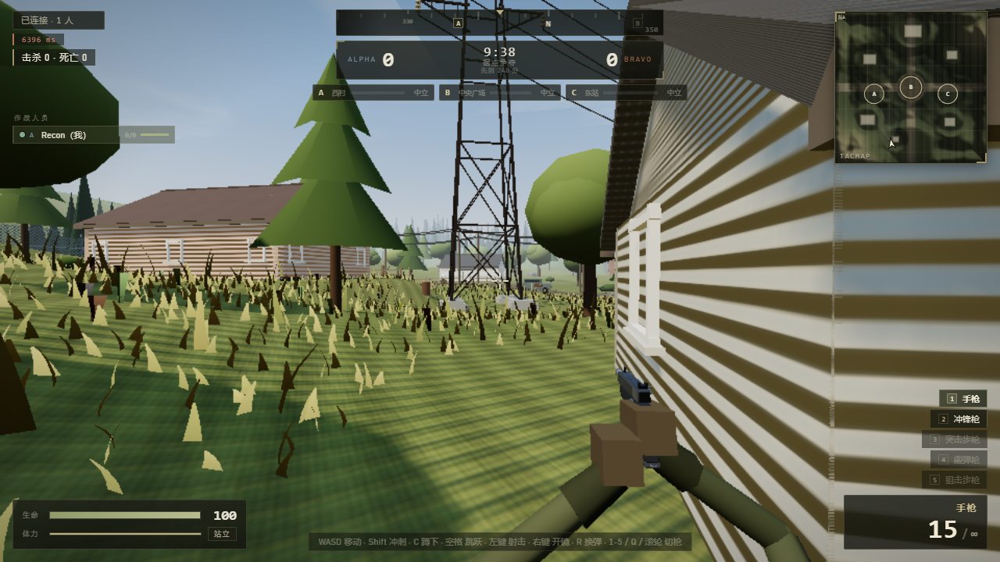

# 郊区战场 · SUBURBAN FRONT

网页版 3D 多人射击游戏（**Vite + Three.js + Node.js/ws**），从"霓虹竞技场"原型整体重制为**写实郊区战场**：
起伏草地、可进入民房、26m 输电塔与悬链电缆、杂草/树木/石堆、真实太阳光照与阴影、精密程序化枪械、
真实开镜与狙击镜、程序化分层枪声、重构命中反馈（白十字 / 爆头红斜线 X）、无曳光弹、真人级角色骨骼与 AI 寻路视野。
玩法为 **据点争夺（Domination）+ 冲刺/蹲/滑铲 + 5 连杀 UAV**。



> 截图来自本机 headless Chrome（软件渲染 SwiftShader，低帧率下仍可运行；真实 GPU 上会开启阴影、Bloom 与满密度草地）。
> 更多截图见 `screenshots/`：`menu.png`、`warmup.png`、`hills.png`、`characters.png`、`scope.png`、`ads-pistol.png`、`ads-ak47.png`、`smg-reddot.png`、`dmg-indicator.png`。

## 快速开始

```bash
npm install
npm run dev          # 同时启动游戏服务器(:3001) 与 Vite(:4173)
```

浏览器打开 http://localhost:4173 ，输入昵称 → 进入战场。

- 局域网联机：`ipconfig` 查本机 IP，好友访问 `http://你的IP:4173`。
- 多开浏览器标签页即可多人对战；服务器会自动补充 AI（默认 5 个，`BOTS_MAX=0` 关闭）。

生产模式：

```bash
npm run build        # 产物输出 dist/
npm start            # 服务器监听 3001，同时托管前端与 WebSocket
```

> 若构建时遇到 Windows 临时目录权限问题，可把 TEMP/TMP 指向工程内目录后再构建
> （`set TEMP=%cd%\.tmp & set TMP=%cd%\.tmp & npm run build`）。
> 端口可用 `PORT` 环境变量修改（游戏服务器），`VITE_PORT` 修改 Vite 端口。
>
> **关于 `[vite] ws proxy socket error: Error: read ECONNRESET`**：这是正常现象——
> 关闭标签页 / 刷新页面 / 断网时浏览器会直接断开 TCP，Vite 的 WebSocket 代理会把这条
> 连接重置记录成日志，紧接着服务器打印 `[-] 玩家名 离开`。不影响游戏，
> 也**不是崩溃**。现在 `vite.config.js` 已对 `ECONNRESET/EPIPE` 做静默处理，正常断开不再刷屏。

## 操作

> 游戏内**屏蔽了所有非必要快捷键**（数字键切枪、Q、B、Tab、F1、F5 等一律不响应，也不会触发浏览器默认行为），
> 避免误触影响操作；切换武器只通过鼠标滚轮。

| 按键 | 作用 |
| --- | --- |
| WASD / 方向键 | 移动 |
| Shift | 冲刺（消耗体力，停冲后恢复） |
| C | 蹲下；冲刺中按 C 滑铲（0.7s，冷却 1.2s）。**蹲下只使用 C**，避免与 `Ctrl+W` 等浏览器组合键冲突 |
| 空格 | 开局准备阶段开始 10 秒倒计时；比赛中跳跃（消耗少量体力） |
| 鼠标左键 | 射击（全自动按住连发 / 半自动需再按） |
| 鼠标右键 | 开镜（机瞄/红点/狙击镜，真实 FOV 放大 + 瞄具对齐） |
| R | 换弹（空仓换弹更慢） |
| 鼠标滚轮 | 在已持有武器间切换 |
| ~ / Enter | 打开后台命令控制台（Esc 或点击外部关闭；**按住 Ctrl/Alt 时不会误触**） |

## 后台命令

按 **~**（波浪键）或 **Enter** 呼出控制台，输入命令后按 Enter 执行（↑/↓ 可翻历史）。

| 命令 | 作用 |
| --- | --- |
| `/god` | **本人 GOD 模式**：一次性发出全部 5 把武器并每把 `+300` 子弹，同时**无敌 120 秒**（不掉血、不消耗护甲） |
| `/god 30` | 自定义无敌时长（秒，1~600） |
| `/dark` | 切换到**黑夜**（太阳/环境光/天空/雾整体压暗，约 1.8s 平滑过渡，全服同步） |
| `/light` | 切换回**白天** |
| `/env` | 查看当前是白天还是黑夜 |
| `/add 1 ai` | 增加 1 个 AI（默认加入 bravo 敌军） |
| `/add 3 ai` | 增加 3 个 AI（单次上限 20） |
| `/add -1 ai` | 减少 1 个 AI（移除最后加入的那个） |
| `/add clear ai` | 清空所有 AI |
| `/add 2 ai alpha` | 指定阵营增加友军 AI（`alpha` 友军 / `bravo` 敌军） |
| `/bots` | 查看当前 AI 数量 |
| `/help` | 查看命令帮助 |

> - 结果会同时显示在控制台日志与屏幕顶部提示中；AI 的增删、昼夜与 GOD 均对局内即时生效，无需重开。
> - GOD 期间屏幕顶部显示金色 **GOD 无敌** 徽标与剩余秒数；被击中时会出现金色闪光并提示"伤害已免疫"，其他人射击你会看到"XX 处于无敌状态"。
> - 昼夜是**全服共享**状态，后加入的玩家会自动同步到当前昼夜。

## 玩法

- **开局流程**：进入战场后先显示"按 空格 开始战斗"；由真人玩家按下空格后进入 **10 秒倒计时**，
  倒计时结束才正式开赛。等待/倒计时期间禁止开火、据点不推进、AI 冻结；比赛结束后回到等待阶段，再由真人开始下一局。
- **钢制插板（默认护甲）**：每名玩家出生自带 100 点钢制插板，**躯干伤害 80% 由插板吸收**（20% 进入生命），
  头部/腿部不享受减免（保留爆头与打腿价值）；插板被击穿后溢出伤害正常结算，死亡重生后重新装备满插板，
  拾取"钢制插板"道具可恢复护甲。HUD 左下角显示"护甲"。
- **据点争夺 Domination**：A（西村）/ B（中央广场）/ C（东站）三个据点。
  占领 6s 满进度，人数越多越快；双方同处据点时争夺暂停；无人时进度回退。
  每拥有一个据点 +1 分/秒，先到 **240 分** 或 10 分钟时间到、分数高者获胜；赛后 8s 自动重置。
- **战术机动**：冲刺/蹲下/滑铲/跳跃，姿态影响移速、散布与命中盒（蹲下更难被击中）。
- **连杀奖励**：5 连杀（不死）→ 全队 UAV 10 秒，小地图与头顶标记暴露敌军位置。
- **拾取**：A→AK47、B→狙击枪、C→霰弹枪 的固定武器箱（30s 刷新），以及医疗包/钢制插板/加速消耗品。
- **AI**：alpha（玩家 + 友军 AI）vs bravo（敌军 AI），AI 会占点、找掩体、包抄、听枪声、记忆目标。

## 重制内容对照

| 需求 | 实现 |
| --- | --- |
| 郊区地图 / 草地 / 起伏山丘 | `shared/world.js` 1m 确定性高度场（6 座山丘 + 多层噪声 + 平整垫），地形网格逐顶点采样，顶点色 + 细节贴图 + 法线 |
| 小房子 | 6 栋可进入建筑，墙体 100% 由 `houseWallSegments()` 碰撞数据生成（门洞/门楣/门廊/烟囱/墙板法线） |
| 大型输电架 | 2 座 26m 四腿收分桁架塔 + 横担 + 绝缘子 + 5 根悬链电缆 + 路边电线杆 |
| 杂草 | 草叶/高杂草/野花三层 InstancedMesh，顶点风摆 + 玩家压草 + 距离淡出 |
| 真实光照 | 程序化天空球 + 太阳光晕 + 双层云、PMREM 环境反射、2048 阴影（跟随玩家、纹素对齐）、SSAO 风格环境、ACES + Bloom + 调色后期、指数雾 |
| 人物脚手协调 | 写实士兵分段模型（12 draw call/角色）+ 双骨骼 IK：右手/左手分别 IK 到武器握持点，武器严格沿瞄准方向；步态/蹲/滑铲/换弹/受击/死亡动画 |
| 瞄准器开镜不是摆设 | `scope.js` 按枪型设置"眼到照门"的真实距离（手枪 0.27m / 步枪 0.23m / 红点 0.25m），相机贴近照门；枪托等后部结构被相机近裁剪自然裁掉，看到的是真实机瞄/红点视界；狙击镜真实 FOV 放大 + 圆形分划遮罩/密位/暗角/色差 + 呼吸摆动 + 开镜灵敏度缩放。**开镜射击散布上限 0.004rad（≈0.23°，100m 偏差 < 40cm），子弹几乎是一个点，后坐力仍存在需要压枪** |
| 枪械更精密 | 5 把枪 67~151 个程序化部件（倒角机匣、抛壳口、拉机柄、导轨齿、护木散热孔、弯弹匣、握把纹、枪托、枪口装置、机械瞄具/红点/6 倍镜） |
| 枪声真实 | WebAudio 分层合成：瞬态 crack + 低频 thump + 机械 click + 程序化户外 IR 卷积拖尾；5 枪独立音色、距离低通/衰减/声像/声速延迟；环境风声/鸟虫声 |
| 击中特效重构 | 普通命中=**白色十字**（26px/0.18s），爆头=**红色斜对角线 ×**（40px/0.4s 强发光），击杀强化；粒子血雾/尘土/木屑/火花 |
| 预瞄光点真实 | 动态准星随散布/移动/开镜变化；红点镜为真实 3D 发光点（镜片近乎透明的抗反射镀膜、镜框中间镂空，红点不参与深度测试），开镜时与视线对齐 |
| 不要曳光弹 | 全工程无曳光弹/弹道光柱；只有枪口焰、弹壳、烟尘、命中粒子 |
| AI 寻路与视角 | 1m 导航网格 + A* 8 邻接 + 路径平滑；110° 视锥/55m、双点 LOS、发现延时、听觉（枪声/脚步）、情报共享、6s 记忆外推、掩体/包抄/占点；**难度调校为普通玩家水平**（反应 340~720ms、瞄准误差下限 ≈2.6°、点射有停顿、射速 ×0.7），实测 20 秒移动靶 AI 命中率约 5% |
| 开局流程 / 护甲 | 真人空格开始 10s 倒计时；出生自带 100 点钢制插板：**任何部位受击都会消耗插板**（躯干吸收 80% / 腿 55% / 头 30%），HUD 护甲条实时下降 |
| 受击方向 | 屏幕中心辐射的**正态分布（高斯钟形）曲线扇形**：尖端+发光点精确指向伤害来源，越靠近中心越红 |
| 玩法创新 | 据点争夺 + 冲刺/蹲/滑铲 + 5 连杀 UAV + 武器箱刷新 |
| 进入卡顿优化 | ① 程序化贴图**分帧上传**（主菜单阶段每帧 2 张，进入前全部就绪）；② 材质/着色器分 3 批预编译；③ 地形与草地/杂草/野花按 4×4 区块拆分，视锥裁剪 + **按距离的 LOD 流式**（远处区块整块关闭、中距半密度） |

## 武器

| 武器 | 伤害（身体/爆头/腿） | 射速 | 弹匣 | 备弹 | 定位 |
| --- | --- | --- | --- | --- | --- |
| 手枪 | 26 / 62 / 21 | 半自动 0.155s | 15 | ∞ | 稳定兜底 |
| 冲锋枪 | 16 / 35 / 12 | 全自动 0.078s | 30 | 150 | 近身泼水，红点镜 |
| 突击步枪 | 24 / 59 / 19 | 全自动 0.10s | 30 | 120 | 中距全能，需压枪 |
| 霰弹枪 | 11×8 弹丸 | 泵动 0.85s | 6 | 30 | 贴脸爆发，远距衰减到 25% |
| 狙击枪 | 95 / 228 / 66 | 栓动 1.3s | 5 | 25 | 6 倍镜，爆头必杀 |

后坐力按武器独立（可学习压枪）；开镜/蹲下收紧散布，移动/冲刺放大散布；距离衰减与部位倍率前后端一致。

## 架构

```
├─ index.html / src/style.css     写实军事 HUD 骨架与样式
├─ src/
│  ├─ main.js                     集成：渲染循环、网络、输入、特效/音效调度、HUD 接线
│  ├─ player.js                   本地玩家：固定步长预测移动、体力/姿态、开镜/后坐力/武器状态机
│  ├─ scope.js                    瞄具对齐、第一人称武器姿态、双骨 IK 手臂、开镜控制器
│  ├─ hud.js                      HUD 逻辑（小地图/罗盘/据点/击杀信息/命中标记/开镜遮罩）
│  ├─ world.js + world/*.js       场景：地形/植被/建筑/输电塔/道具/光照/后期/画质档
│  ├─ models/character.js         写实士兵骨骼、IK 持枪、战术动作
│  ├─ models/weapons.js           5 把精密程序化枪械 + 瞄具几何与握持点
│  ├─ effects.js                  池化战斗粒子（枪口焰/弹壳/尘土/血雾，无曳光弹）
│  ├─ audio.js                    程序化分层枪声/环境声/空间定位
│  └─ net.js                      WebSocket 客户端
├─ shared/
│  ├─ world.js                    高度场、布局、碰撞体、物理、射线、据点/出生/道具点（前后端共用）
│  ├─ weapons.js                  武器数值/散布/伤害/开镜参数（前后端共用）
│  └─ map.js                      兼容 re-export 层
├─ server/
│  ├─ server.js                   权威服务器：据点/比赛/UAV/机动/武器/道具/AI 集成/协议
│  ├─ ai.js                       AI 感知/战斗/占点决策
│  └─ nav.js                      导航网格 + A* 寻路
└─ scripts/
   ├─ smoke.mjs                   共享世界 + 服务器单元 + WebSocket 端到端（96 项）
   ├─ browser-test.mjs            浏览器端到端（CDP，25 项，含截图）
   ├─ validate-world.mjs          世界数据/物理/射线/可达性自检（40 项）
   ├─ cdp.mjs                     无 Playwright 依赖的 Chrome DevTools 客户端
   ├─ serve-dev.mjs               原生 ES Module 静态服务器（importmap，无需打包）
   └─ dev.mjs                     同时启动游戏服务器与 Vite
```

### 共享世界合同（要点）

- 地形高度 `heightAt(x,z)`：固定哈希 value-noise + 山丘 + 平整垫 → 1m 采样网格双线性插值。
- 碰撞体 `COLLIDERS`：全部带 `y0/y1` 的 AABB（房屋墙、栅栏、树、石、车、塔、工事、边界）。
- 物理 `movePlayerHorizontal()` + `stepPlayerPhysics()`：客户端预测与服务器权威同一套代码。
- 射线 `raycastWorld()` / `losBlocked()`：子弹命中、视线遮挡、AI 感知共用。
- 命中盒 `hitboxesFor(p)`：头球 + 躯干/腿胶囊，蹲/滑铲整体压低。
- 武器 `shared/weapons.js`：伤害/散布/后坐力/开镜 FOV/弹药/音色提示。

服务器 20Hz 全量快照广播；客户端预测 + 对账；权威弹药/换弹/切枪/命中/据点/比赛/AI。

## 画质

菜单内可切换 `自动 / 高 / 中 / 低`，或用 URL 无参数时自动检测软件渲染（SwiftShader/llvmpipe）降到低档；
低帧率时会自动逐级降档（关后期/降阴影/降草密度/降分辨率）。高画质包含阴影、Bloom、调色后期与满草。
草叶改为 2 段几何并限制总量（3.6 万株），高画质整场约 19 万三角面（旧版约 44 万），显著降低草地掉帧。

## 测试

```bash
node scripts/validate-world.mjs   # 世界/物理/射线/可达性（40 项）
node scripts/smoke.mjs            # 共享逻辑 + 服务器 + WebSocket（96 项）
node scripts/browser-test.mjs     # 真实浏览器端到端（25 项，需要本机 Chrome/Edge）
npm run build                     # 生产构建
node scripts/_prod.mjs            # （开发期）dist 生产构建冒烟（已随临时脚本清理）
```

`browser-test.mjs` 使用自带的极简 CDP 客户端（`scripts/cdp.mjs`）通过 TCP 调试端口驱动 Chrome：
不依赖 Playwright，也不依赖打包（`serve-dev.mjs` 用 importmap 直接托管源码），因此在受限环境也能跑。
截图输出到 `../.verify/`。回归断言覆盖：开局等待/空格/10 秒倒计时/开赛、出生护甲 100、开镜时手臂仍贴合枪身、
命中产生红色血雾粒子、远程枪口焰位于枪口而不是头部。

当前验证结果：

- `validate-world.mjs`：**40/40**
- `smoke.mjs`：**107/107**
- `browser-test.mjs`：**32/32**（软件渲染下亦通过；截图见 `../.verify/`）
- `vite build`：通过（dist 约 935KB JS / 28KB CSS）

## 自动化调试接口

浏览器控制台 `window.__game` 暴露：

- `player` / `local` / `remotes` / `camera` / `world` / `effects` / `scope` / `hud` / `net`
- `fps` / `scopeActive` / `hitmarkerPart` / `errors` / `tracerCount`（恒为 0，验证无曳光弹）
- `send(msg)`（可直接发调试消息）、`setQuality(q)`、`serverPlayers`
- `window.__hud` 为 HUD 实时状态（生命/弹药/开镜/命中/据点/小地图等）

服务器 `DEBUG=1` 时支持 `debug_pos / debug_spawn_bot / debug_spawn_item / debug_zone / debug_hp / debug_score / debug_time`。

## 已知限制

- 全部为程序化资源（无外部模型/贴图/音频），角色/树木为风格化写实，不是扫描级资产。
- 房屋可进入但无室内家具与二层；屋顶不参与碰撞（约定子弹可穿屋顶）。
- AI 使用 1m 网格，门洞过窄（约 1.3~1.6m）时 AI 不进屋，会在屋外绕行/利用外墙掩体。
- 软件渲染（无 GPU）下帧率较低，已自动降档，建议真实 GPU 浏览器体验高画质。
- 单房间单局，无账号/排位/房间列表系统；真人上限 8 人，AI 默认 5 个。

## 数值/调试参考

- 世界尺寸 140×140m，玩家眼高 1.64m（蹲 1.05 / 滑铲 0.82），行走 5.4、冲刺 8.4、蹲行 2.5 m/s。
- 据点 A(-34,6) / B(0,0) / C(34,6)，占领 6s（人数加速），240 分或 600s 决胜。
- `BOTS_MAX` / `ITEMS_MAX` / `PORT` / `DEBUG` 环境变量可调。
